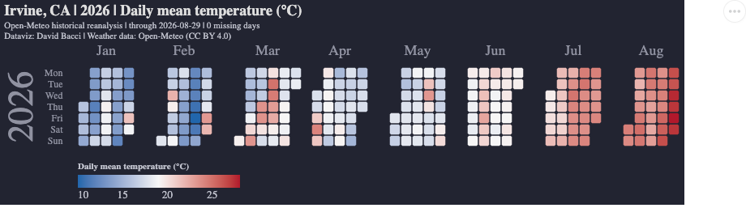
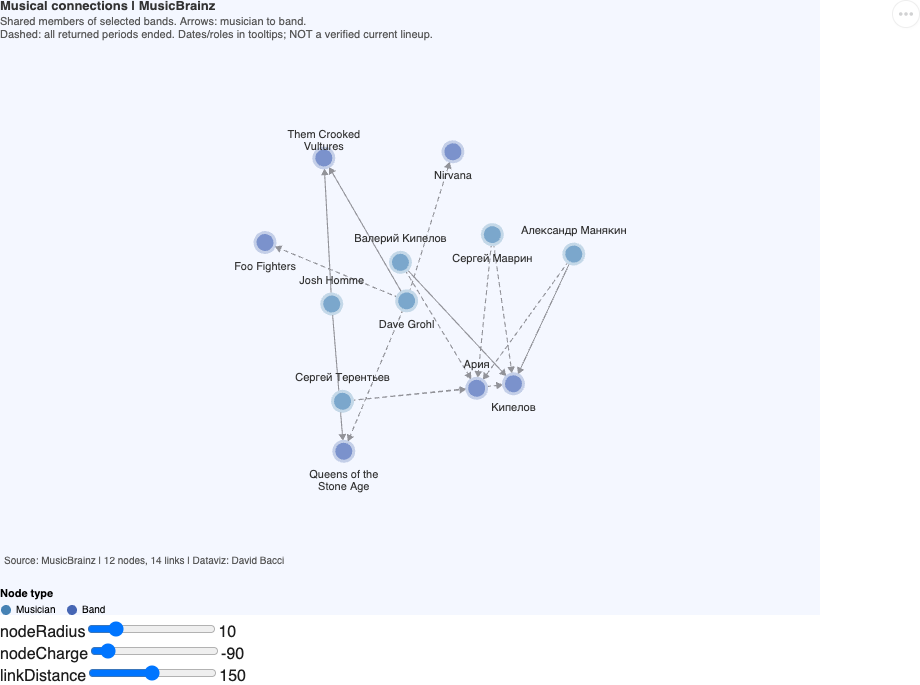
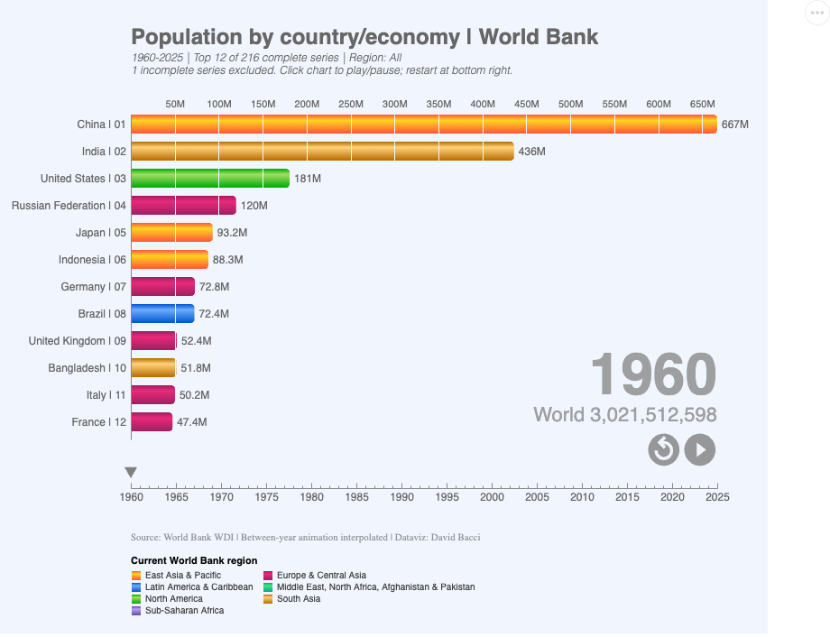
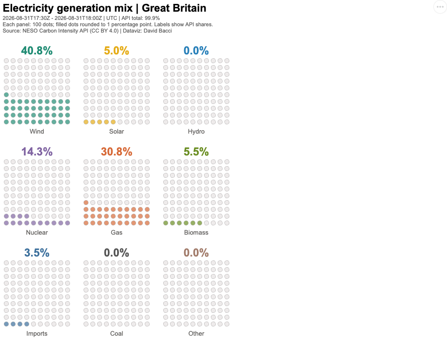

In [Build Vega-Lite HTML Reports with PowerShell](/articles/2026/10/build-vega-lite-html-reports-with-powershell/), PowerShell downloads data, builds a Vega-Lite specification, and saves the resulting HTML as a report. Nothing in that approach is specific to a file. `Show-VegaLite` returns HTML, and the final pipeline command decides where it goes.

A notebook can consume the same HTML instead:

```powershell
$spec |
    Show-VegaLite |
    Display -MimeType 'text/x-verso-widget'
```

That small change places the output beside the code and explanation that produced it. The output can be saved with the notebook, inspected later, and regenerated after changing a parameter or refreshing the data.

This article examines a larger example: the [Deneb Showcase PowerShell notebook](https://github.com/DataficationSDK/Verso/tree/main/samples/notebooks/powershell/deneb-showcase) included with [Verso](https://github.com/DataficationSDK/Verso). It contains 29 cells and ten saved Vega or Vega-Lite visualizations backed by public datasets.

[Open the saved notebook in the Verso Viewer](https://www.versonotebooks.com/share/github/DataficationSDK/Verso/blob/main/samples/notebooks/powershell/deneb-showcase/deneb-showcase.verso). The Viewer is read-only: it displays saved outputs, but it doesn't execute PowerShell or refresh remote datasets.

## From an HTML report to a notebook cell

The standalone report and the notebook share the same central flow:

```text
PowerShell objects
    -> Vega or Vega-Lite specification
    -> HTML containing Vega-Embed
    -> a destination chosen by the caller
```

For a file, the destination is `Set-Content`. Verso uses its rich display pipeline:

```powershell
$html | Display -MimeType 'text/x-verso-widget'
```

The Deneb Showcase keeps its display cells concise by performing this final `Display` inside `Show-DenebSpec`:

```powershell
$document | Display -MimeType 'text/x-verso-widget'
```

A helper that follows the pipeline-oriented design from the previous article can leave that last decision in the cell instead:

```powershell
$calendarTemplate |
    Set-WeatherCalendarYear `
        -Weather $irvineWeather `
        -Year $year `
        -Metric $metric |
    Show-VegaLite |
    Display -MimeType 'text/x-verso-widget'
```

Both versions build the same kind of HTML widget. The difference is whether the helper or the caller chooses the destination.

## Separate the notebook into responsibilities

The notebook isn't ten hand-written datasets embedded in chart specifications. It separates four responsibilities:

1. Download a pinned Vega or Vega-Lite template adapted from the [Deneb Showcase](https://github.com/PBI-David/Deneb-Showcase).
2. Download and validate current data from a public source.
3. Transform that data into the shape expected by the template without mutating the original specification.
4. Render the resulting specification as a Verso widget.

`helper.ps1` provides the common pipeline commands:

- `Get-DenebShowcaseSpec` downloads a pinned specification.
- `Set-DenebSpecData` replaces inline or named data sources on a copy.
- `Set-DenebSpecSize` changes explicit dimensions without rewriting the chart.
- `Show-Vega` and `Show-VegaLite` select the correct grammar and renderer.

Dataset-specific scripts handle Open-Meteo, SIPRI, Microsoft financial statements, FDIC bank failures, Wikidata, MusicBrainz, the World Bank, the NASA Exoplanet Archive, and NESO electricity-generation data.

Most examples deliberately use two cells. The first downloads and validates a dataset; the second selects a period or filter and renders it. You can change a year or a Top N value repeatedly without downloading the source again.

## Calendar heatmap: change a parameter, not the pipeline

The weather example downloads Irvine daily observations once and exposes the available years and missing-value counts. The display cell chooses a year and metric:

```powershell
$year = (Get-Date).Year
$metric = 'Temperature' # Or 'Precipitation'

$calendarTemplate |
    Set-WeatherCalendarYear `
        -Weather $irvineWeather `
        -Year $year `
        -Metric $metric |
    Show-VegaLite
```



The saved output is a snapshot. Rerunning the download cell can extend the current year, while rerunning only the display cell reuses the data already held by the PowerShell kernel.

## Relationship data as a force-directed graph

Vega isn't limited to statistical charts. One notebook cell queries MusicBrainz for shared and former members of several bands, including Ария and Кипелов, then binds the returned nodes and edges to a force-directed graph.

```powershell
$musicTemplate |
    Set-DenebRelationshipGraph -Graph $musicConnections |
    Show-Vega -Renderer canvas
```



The qualifiers matter as much as the picture. Dashed links mean that all returned membership periods ended; the graph isn't presented as a verified current lineup. Dates and instruments remain available in tooltips.

This is useful for operational data too: collect relationships with PowerShell, retain their provenance, and use the graph as a navigable view instead of treating it as the source of truth.

## Saved output can remain interactive

The World Bank example is a population bar-chart race. PowerShell downloads the time series, checks completeness, selects a period and region, and binds the selected economies to the template:

```powershell
$startYear = 1960
$endYear = $worldPopulation.LatestYear
$topN = 12
$region = 'All'
$secondsPerYear = 0.6

$populationTemplate |
    Set-WorldBankPopulationRace `
        -Population $worldPopulation `
        -StartYear $startYear `
        -EndYear $endYear `
        -TopN $topN `
        -Region $region `
        -SecondsPerYear $secondsPerYear |
    Show-Vega -Renderer canvas
```



The notebook saves the HTML widget, including its specification and selected data. The Viewer can therefore display the chart and its controls without starting a PowerShell kernel. It still loads pinned Vega JavaScript runtimes from jsDelivr, so saved doesn't mean completely offline.

## Vega-Lite uses the same path

The final example downloads recent completed half-hour intervals from NESO and renders the Great Britain generation mix as nine waffle panels:

```powershell
$intervalStartUtc = $gbGeneration.LatestFromUtc

$electricityTemplate |
    Set-GbGenerationWaffle `
        -Mix $gbGeneration `
        -FromUtc $intervalStartUtc |
    Show-VegaLite -Renderer canvas
```



Each panel contains 100 dots. Filled dots are rounded to one percentage point, while the labels retain the API values. The notebook reports missing intervals instead of silently treating an incomplete response as complete.

## Keep data adapters outside the notebook

A notebook becomes difficult to maintain when every cell contains downloading, parsing, validation, transformation, visualization, and presentation code at once. The Showcase keeps reusable work in adjacent `.ps1` files and leaves cells focused on the narrative:

```powershell
#!import ./gb-electricity.ps1

$electricityTemplate = Get-DenebShowcaseSpec `
    'Waffle Charts/Spec.json'
$gbGeneration = Get-GbGenerationMix -Hours 48
```

This provides several practical benefits:

- Functions can be tested without launching the notebook UI.
- Source-specific caveats stay close to the parsing code.
- Display cells remain short enough to explain.
- A fresh kernel can reconstruct state by rerunning imports and downloads.
- The same adapter can later feed an HTML report, another notebook, or a scheduled job.

The `.verso` file still owns the sequence, prose, parameters, and saved outputs. The scripts own reusable behavior.

## Run and share the notebook

To run the sample locally, clone Verso and open:

```text
samples/notebooks/powershell/deneb-showcase/deneb-showcase.verso
```

Keep the adjacent `.ps1` files with it so the relative `#!import` directives resolve. The notebook needs internet access to refresh its datasets and load the pinned Vega runtimes. It doesn't require API keys or additional PowerShell modules.

After a kernel restart, saved outputs remain visible, but PowerShell variables don't. Rerun the helper import, the relevant download cell, and then the display cell before changing parameters.

Readers who only want to inspect the result can use the [Verso Viewer](https://www.versonotebooks.com/share/github/DataficationSDK/Verso/blob/main/samples/notebooks/powershell/deneb-showcase/deneb-showcase.verso). The Viewer URL above follows `main`; use a commit-pinned URL when you need an immutable snapshot.

## The useful boundary is HTML

Vega and Vega-Lite don't require a notebook, and Verso doesn't require chart-specific PowerShell objects. The useful boundary is HTML:

```powershell
# A file report
$spec |
    Show-VegaLite |
    Set-Content ./report.html -Encoding utf8

# A Verso cell
$spec |
    Show-VegaLite |
    Display -MimeType 'text/x-verso-widget'
```

The first form creates a portable artifact for a ticket, build, or static site. The second preserves the analysis around that artifact and makes iteration immediate. PowerShell prepares the data in both cases; Vega describes the visualization in both cases; only the final destination changes.

## References

- [Deneb Showcase PowerShell notebook source](https://github.com/DataficationSDK/Verso/tree/main/samples/notebooks/powershell/deneb-showcase)
- [Open the saved notebook in Verso Viewer](https://www.versonotebooks.com/share/github/DataficationSDK/Verso/blob/main/samples/notebooks/powershell/deneb-showcase/deneb-showcase.verso)
- [Verso repository](https://github.com/DataficationSDK/Verso)
- [Deneb Showcase](https://github.com/PBI-David/Deneb-Showcase)
- [Vega documentation](https://vega.github.io/vega/)
- [Vega-Lite documentation](https://vega.github.io/vega-lite/)
